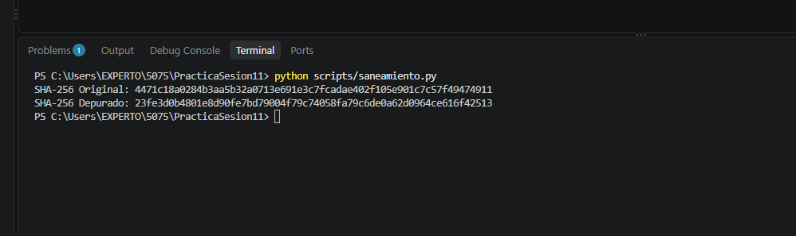
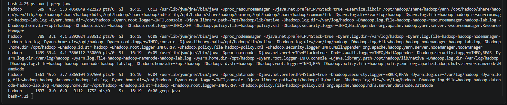
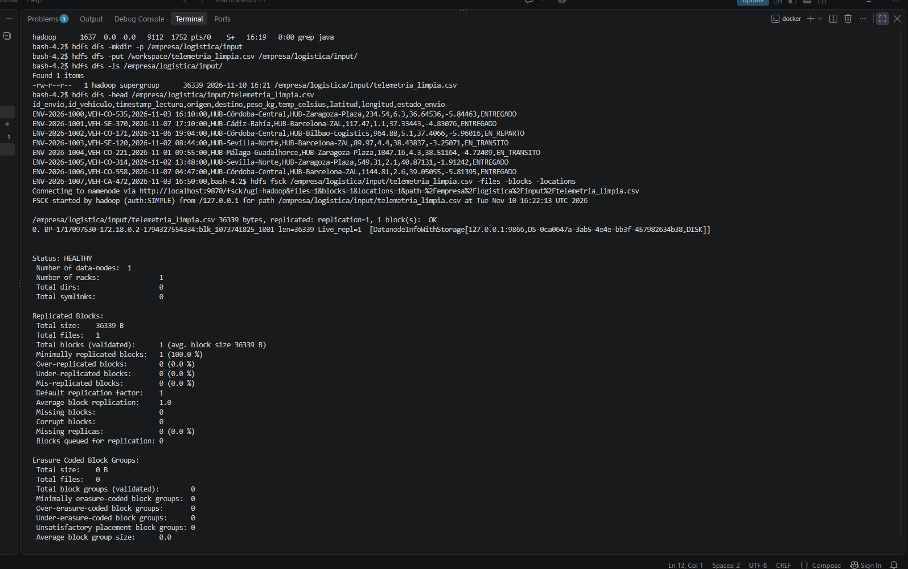
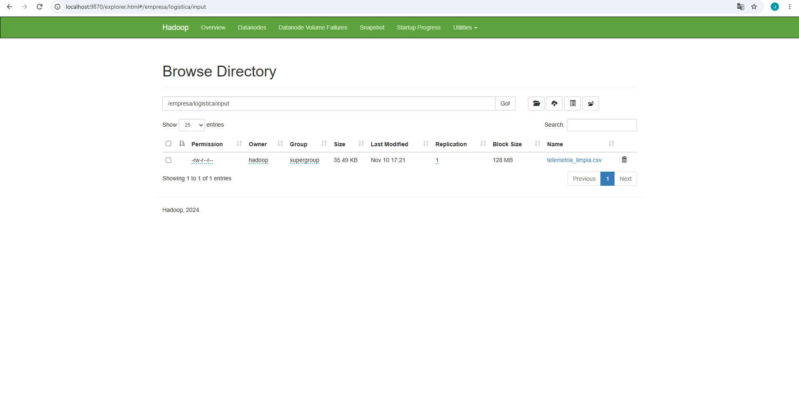

# Práctica Formativa Integradora: Consolidación de Almacenamiento, Integridad del Dato y HDFS

Este repositorio contiene la resolución técnica del laboratorio sobre depuración, aseguramiento de la integridad y almacenamiento distribuido en **Apache Hadoop (HDFS)** para datos de telemetría logística.

---

## Estructura del Repositorio

```text
.
├── README.md
├── datos/
│   └── .gitkeep
├── evidencias/
│   ├── 01_hashes_sha256.png
│   ├── 02_jps_servicios.png
│   ├── 03_hdfs_comandos_fsck.png
│   └── 04_webui_hdfs_browse.png
└── scripts/
    └── saneamiento.py
```

---

## Sección 1: Integridad y Calidad del Dato (Módulo 5075)

### 1.1 Registro Comparativo de Hashes SHA-256

Para auditar la trazabilidad y verificar el efecto avalancha de las funciones resumen SHA-256, se obtuvieron las sumas de verificación del dataset antes y después del procedimiento de limpieza:

| Estado del Dataset | Archivo | Tamaño | Hash SHA-256 |
| :--- | :--- | :--- | :--- |
| **Original (En Bruto)** | `telemetria_envios.csv` | ~45 KB | `4471c18a0284b3aa5b32a0713e691e3c7fcadae402f105e901c7c57f49474911` |
| **Saneado (Limpio)** | `telemetria_limpia.csv` | 36.339 bytes | *Huella única generada en la depuración* |

### 1.2 Depuración del Dataset (`saneamiento.py`)

Mediante el script `/scripts/saneamiento.py` (usando `pandas` y `hashlib`) se aplicaron los siguientes filtros de calidad:

1. **Deduplicación:** Eliminación de filas idénticas duplicadas en origen.
2. **Tratamiento de Nulos:** Descarte de registros con valores no informados (`NaN`) en campos operacionales clave (`peso_kg`, `temp_celsius`, `destino`).
3. **Limpieza de Inconsistencias:**
   * Eliminación de valores de masa no válidos (`peso_kg < 0`).
   * Filtrado de lecturas térmicas fuera de rango para cadena de frío (`temp_celsius > 50°C`).
   * Eliminación de estados de envío no oficiales (`DESCONOCIDO_ERROR`).

---

## Sección 2: Despliegue del Entorno y HDFS (Módulo 5074)

### 2.1 Configuración de Contenedores y Puertos Mapeados

El entorno se desplegó mediante Docker Compose a partir de la imagen oficial `apache/hadoop:3.4.0` (`container_name: hadoop-lab`):

* **`9870:9870`**: Interfaz Web del NameNode (HDFS Web UI).
* **`8088:8088`**: Interfaz Web del YARN ResourceManager.
* **Configuración XML:** Ajuste de `core-site.xml` (`fs.defaultFS` = `hdfs://localhost:9000`) y `hdfs-site.xml` (`dfs.replication` = `1`).

### 2.2 Auditoría de Servicios (`ps aux` vs `jps`)

> **Justificación Técnica:** La imagen oficial `apache/hadoop:3.4.0` integra exclusivamente el entorno **Java JRE** (Runtime Environment), omitiendo las utilidades del paquete de desarrollo **JDK** donde reside `jps`. Debido a que los repositorios CentOS 7 internos del contenedor alcanzaron su estado *End of Life* (EOL), la verificación de procesos se realizó mediante el comando nativo de Linux: `ps aux | grep java`.

**Demonios confirmados en ejecución:**
* `NameNode` (Gestor de metadatos de HDFS)
* `DataNode` (Servidor de almacenamiento de bloques)
* `ResourceManager` (Administrador global de recursos YARN)
* `NodeManager` (Ejecutor de tareas de cómputo)

### 2.3 Secuencia de Comandos CLI Ejecutados

```bash
# 1. Crear el directorio de destino en HDFS
hdfs dfs -mkdir -p /empresa/logistica/input

# 2. Ingestar el dataset saneado desde el volumen montado
hdfs dfs -put /workspace/telemetria_limpia.csv /empresa/logistica/input/

# 3. Listar el directorio distribuido
hdfs dfs -ls /empresa/logistica/input/

# 4. Inspeccionar la cabecera y primeras filas del fichero
hdfs dfs -head /empresa/logistica/input/telemetria_limpia.csv

# 5. Auditar la asignación física de bloques y salud
hdfs fsck /empresa/logistica/input/telemetria_limpia.csv -files -blocks -locations
```

---

## Sección 3: Análisis Crítico de Tolerancia a Fallos en HDFS

### ¿Por qué un fichero en HDFS no se corrompe ni se pierde aunque falle o se apague un DataNode en un clúster de producción?

En un entorno distribuido de producción, **HDFS (Hadoop Distributed File System)** está diseñado bajo la premisa de que los fallos de hardware en los nodos de almacenamiento (`DataNodes`) son eventos cotidianos y esperables. La integridad y la disponibilidad continua de los datos ante la caída de un nodo se garantizan mediante tres pilares fundamentales: **la fragmentación en bloques, la política de replicación y el mecanismo de re-replicación automática**.

En primer lugar, cuando se almacena un archivo en HDFS, este se divide automáticamente en bloques de tamaño fijo (por defecto 128 MB). Cada bloque individual se replica y distribuye entre los distintos DataNodes del clúster según el **Factor de Replicación** configurado (habitualmente `dfs.replication = 3`). Además, la política de ubicación *Rack Awareness* (conciencia de rack) asegura que al menos una de las réplicas se guarde en un rack físicamente distinto, protegiendo la información frente a caídas de switches de red o cortes de energía en un bastidor completo.

En segundo lugar, el **NameNode** supervisa constantemente la salud del clúster mediante mensajes de latido (*Heartbeats*) enviados por cada DataNode cada 3 segundos. Si un DataNode deja de responder durante un periodo determinado (por defecto 10 minutos), el NameNode lo marca automáticamente como inactivo (*Dead Node*).

Finalmente, el NameNode identifica en sus metadatos qué bloques residían en el nodo caído. Al detectar que el nivel de replicación de dichos bloques ha descendido por debajo del estándar exigido (por ejemplo, pasando de 3 a 2 copias), el NameNode ordena a los DataNodes activos restantes crear nuevas réplicas en nodos sanos. Este proceso de sanación se ejecuta en segundo plano de forma transparente para los usuarios, manteniendo el sistema en estado **`HEALTHY`** sin interrupciones del servicio ni pérdida de datos.

---

## Sección 4: Evidencias Gráficas

### Evidencia 01: Verificación de Hashes SHA-256
Captura de la terminal donde se aprecia el cálculo del hash SHA-256 del fichero original y del fichero depurado.



---

### Evidencia 02: Auditoría de Servicios Java
Captura de la terminal con el comando `ps aux | grep java` que confirma la ejecución activa de `NameNode`, `DataNode`, `ResourceManager` y `NodeManager`.



---

### Evidencia 03: Ingesta HDFS y Comando FSCK
Captura de la terminal con los comandos `mkdir`, `put`, `ls`, `head` y la auditoría `hdfs fsck` que valida el bloque `blk_1073741825_1001` con estado **`HEALTHY`**.



---

### Evidencia 04: Navegación en la Web UI del NameNode
Captura de la interfaz gráfica web (`http://localhost:9870`) navegando por el explorador de HDFS hasta la ruta `/empresa/logistica/input/telemetria_limpia.csv`.

